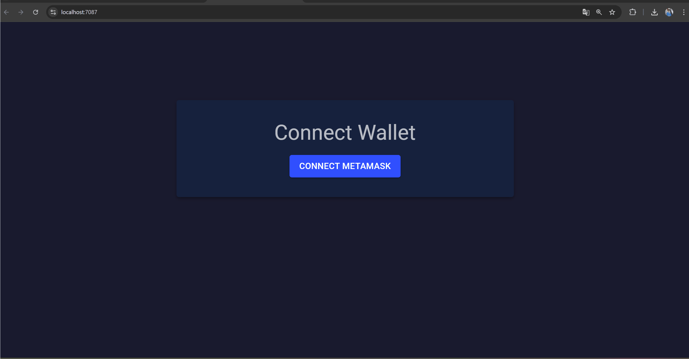

# MathChain


## Overview
MathChain is a Web3 educational platform for high-school mathematics: algebra, calculus,
geometry and trigonometry. Formulas are presented as interactive 3D models, students practise
with automatically generated exercises, and teachers manage their classes and grades.
The blockchain is used where it adds trust: soulbound certificates that anyone can verify
and step-by-step solutions paid in USDC.

## Key Features

### Students
- Interactive 3D formulas built in Blender and a chapter tree.
- Practice Arena with 9 exercises per formula, from Easy to Hard, with new values every time.
- Answers are checked automatically, including the form of the result: expanded, factored or simplified.
- Step-by-step solutions unlocked with a USDC payment that the student only signs in the wallet. MathChain pays the network fee.
- Soulbound certificates for finishing a class or a chapter.

### Teachers
- Classes, assignments, resources, media, messages, gradebook and statistics.
- Class certificates issued on the blockchain.

### Admin
- Curriculum editor for chapters and formulas, stored in PostgreSQL and IPFS.
- Blockchain setup page with the platform account and the solution prices.

### Sign-in
- MetaMask or Phantom, through a signed message and a JWT session.
- Google sign-in for users without a wallet. MathChain derives a blockchain address for them.

## Preview
<div>

</div>

## Architecture
MathChain follows a layered architecture:
- **MathChain.Blazor** is the Blazor WebAssembly client.
- **API** exposes the REST endpoints and handles authentication.
- **MathChain.Application** contains the business logic and the exercise engine.
- **Domain** contains the entities, the interfaces and the domain exceptions.
- **MathChain.Gateway** contains the repositories.
- **MathChain.Persistence** contains the EF Core context and the migrations.
- **MathChain.Infrastructure** and **Blockchain** integrate JWT, Google, IPFS and Nethereum.

### How a solution is bought
1. The student signs a USDC payment authorization in the wallet.
2. MathChain checks the signature and sends the transaction to the MathChainSolutions contract.
3. The contract moves the USDC to the treasury and records the purchase.
4. MathChain confirms the purchase on the blockchain and unlocks the solution.

## Smart Contracts on Base Sepolia
- **MathChainCertificates**: soulbound certificates following ERC-721 and ERC-5192.
  [0x1B09a2e38EF9bfc02Bb4837c01cff1533652a882](https://sepolia.basescan.org/address/0x1B09a2e38EF9bfc02Bb4837c01cff1533652a882)
- **MathChainSolutions**: USDC payments for step-by-step solutions.
  [0xaD11198771D47190c973f474BF5d37065300Cd2B](https://sepolia.basescan.org/address/0xaD11198771D47190c973f474BF5d37065300Cd2B)

## Tech Stack
- **Frontend:** Blazor WebAssembly, MudBlazor, Three.js, KaTeX
- **Backend:** ASP.NET Core 8, EF Core 8, PostgreSQL on Supabase, IPFS
- **Blockchain:** Solidity, OpenZeppelin, Hardhat, Nethereum, Base Sepolia, USDC
- **Testing:** xUnit, Hardhat

## Getting Started
Requirements: .NET 8 SDK, a PostgreSQL database, Node.js for the contracts,
and MetaMask on Base Sepolia with test ETH and test USDC from faucet.circle.com.

1. Clone the repository.
2. Set the secrets with `dotnet user-secrets`. They are never stored in the repository:
   ```bash
   dotnet user-secrets set "ConnectionStrings:MathchainDB" "<connection string>" --project API
   dotnet user-secrets set "Jwt:Key" "<random value of at least 32 bytes>" --project API
   dotnet user-secrets set "Custody:MasterSecret" "<random value>" --project API
   dotnet user-secrets set "Blockchain:IssuerPrivateKey" "<platform account key>" --project API
   ```
3. Apply the migrations:
   ```bash
   dotnet ef database update --project MathChain.Persistence --startup-project API
   ```
4. Set API and MathChain.Blazor as startup projects and run the solution.

## Testing
```bash
dotnet test Tests
cd SmartContracts
npm install
npx hardhat test
```

## Roadmap
- [x] Step-by-step solutions with blockchain payments
- [x] Soulbound certificates
- [x] Unit tests
- [ ] Integration tests
- [x] Account abstraction with smart accounts and a paymaster
- [ ] Custom subgraph
- [ ] Mobile version
- [ ] Exercises and solutions for the whole curriculum

## License
This project is licensed under the MIT License.
